<div align="center">

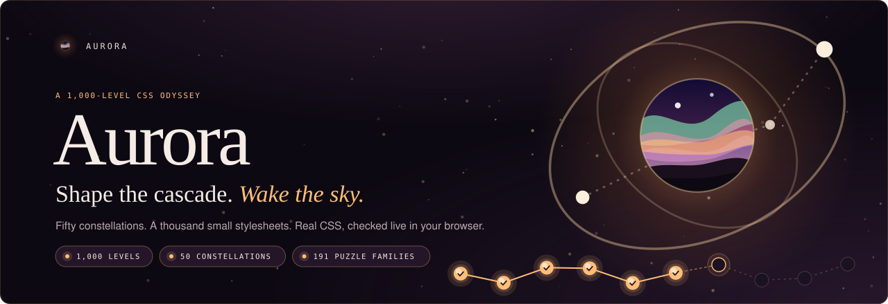

<br/>

<!-- identity -->


<br/>

<!-- stack -->
<a href="https://react.dev"></a>
<a href="https://www.typescriptlang.org"></a>
<a href="https://vite.dev"></a>
<a href="https://codemirror.net"></a>

<br/>

<!-- engine -->


<br/>

<!-- platform -->


<a href="https://hassanireza.github.io/aurora/"></a>

<br/><br/>

*Fifty constellations. A thousand small stylesheets. Light each star by writing the CSS that makes it glow, on your phone, under the northern sky.*

<br/>

[Overview](#overview) · [Features](#features) · [The map](#the-map) · [Architecture](#architecture) · [The check](#the-check) · [Curriculum](#curriculum) · [Progression](#progression) · [Terminal](#terminal) · [Mobile](#mobile) · [Offline](#offline-and-install) · [Design system](#design-system) · [Authoring](#authoring-levels) · [Getting started](#getting-started) · [Deployment](#deployment) · [Notes](#technical-notes)

<br/>

**[Play it live](https://hassanireza.github.io/aurora/)**

</div>

---

<a id="overview"></a>
##  Overview

**Aurora** is a pocket-sized CSS journey under the northern sky. A thousand short styling puzzles are arranged as fifty constellations of twenty stars. You read a prompt, write a few rules and run them. Your stylesheet and the authored answer are rendered side by side by your own browser, the computed styles are compared, and a match lights the star.

The name comes from the ribbons of light that bend across a polar sky, and the interface plays on that: a plum dusk backdrop of drifting specks, a ripple of light wherever you tap, and a sky window with two orbit rings as the mark.

Everything runs on the client:

- **The map** is a vertical climb from the surface at the bottom to the summit at level 1000. Every episode is a constellation whose stars and paths light up as you progress.
- **The editor** is CodeMirror 6 with CSS highlighting, tuned for phones, with auto-closing brackets, no autocorrect and a row of the symbols that phone keyboards bury.
- **The engine** is the browser itself. There is nothing to download and no runtime to boot: both stylesheets are rendered in hidden, script-free frames and what the browser computed is compared. Your code is never sent to a server.

There is no backend, no account and no analytics. Progress is stored in `localStorage`, and after the first visit the app works offline.

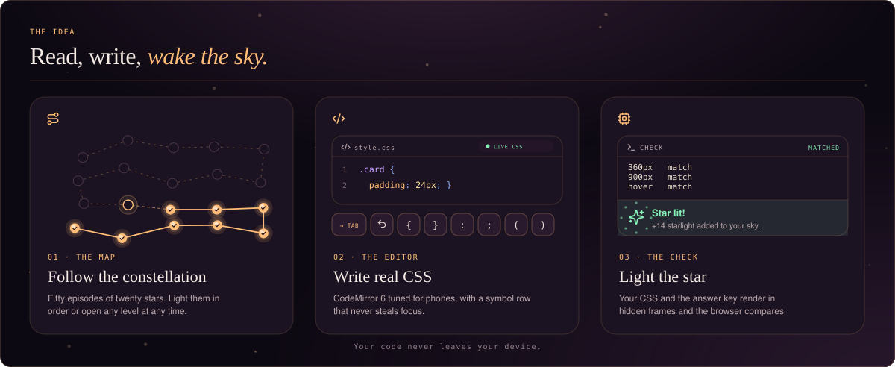

---

<a id="features"></a>
##  Features

<table>
<tr>
<td width="50%" valign="top">

 **The map**
- 1,000 levels in 50 episodes of 20, each drawn as its own constellation
- Stars have three states: unlit, next (pulsing) and lit
- Paths light up when both of their stars are solved
- A **Continue** dock jumps straight to your next level
- A compass opens a sheet to jump to any episode, with progress bars

</td>
<td width="50%" valign="top">

 **The editor**
- CodeMirror 6 with CSS highlighting, search and a custom dusk theme
- Brackets and quotes auto-close and step over, like a real keyboard
- No autocapitalise, autocorrect or smart quotes
- A symbol row: new line, Tab, undo and 25 symbols, none of which steal focus
- Phone focus mode that follows the keyboard through `visualViewport`

</td>
</tr>
<tr>
<td width="50%" valign="top">

 **The check**
- Your CSS and the answer key render into the same scene
- Computed styles are compared at 360 px, at 900 px and with hover and focus held
- Pseudo-elements, keyframes and timing are compared too
- Any CSS that renders the same is a correct answer
- A gentle linter flags typos the browser would silently ignore

</td>
<td width="50%" valign="top">

 **Progression**
- Starlight per level from 10 to 30, 20,900 in total
- A day streak that follows your local calendar
- A hint on demand, and the expected result after two misses
- A burst of light and a haptic tap on every first solve
- Progress saved locally and validated on load

</td>
</tr>
<tr>
<td width="50%" valign="top">

 **Terminal**
- A free CSS sandbox at `#/terminal` with its own markup panel
- A live canvas with 360 and 900 px switches and a HOLD switch for states
- A sheet of ready-made examples to load and remix
- Your work is saved locally and undo is one tap away

</td>
<td width="50%" valign="top">

 **Offline and install**
- A service worker caches the whole shell
- Every level keeps working offline after the first visit
- Add to Home Screen with a standalone, full-screen look
- Icons, a maskable icon and 13 iOS splash screens

</td>
</tr>
<tr>
<td width="50%" valign="top">

 **Design**
- Plum dusk with amber, rose, mint, violet and ice accents
- Ten episode tints that repeat across the fifty constellations
- Playfair Display, DM Sans and DM Mono, bundled with the app
- Respects `prefers-reduced-motion` by switching all animation off

</td>
<td width="50%" valign="top">

 **Safe by construction**
- Learner CSS renders in `sandbox="allow-same-origin"` frames with no scripts
- No network request is made on behalf of your code
- No account, no analytics, no remote fonts

</td>
</tr>
</table>

---

<a id="the-map"></a>
##  The map

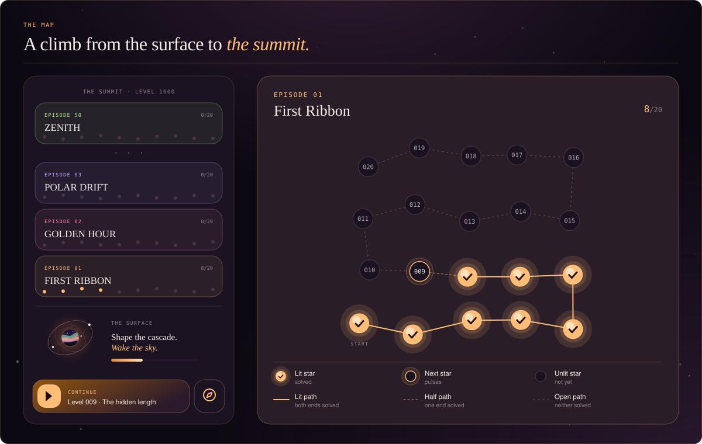

The map reads bottom to top. The **surface** sits at the bottom with the hero, the title and a meter of stars lit, so a new player lands right on it. Fifty episode cards stack above it, newest first, up to **the summit** at level 1000.

Each episode is a snake of twenty stars that climbs from the bottom-left, laid out by a deterministic function with a little seeded drift, so every constellation has its own shape and never changes between visits.

| Element | Behaviour |
|---|---|
| Lit star | Solved. Glows in the episode's tint and shows a check |
| Next star | The first unsolved level on the whole path. A pulsing ring |
| Unlit star | Not solved yet. Shows its level number |
| Lit path | Both ends are solved |
| Half path | One end is solved |
| Open path | Neither end is solved |
| Episode card | Shows `n/20`, or a glowing **COMPLETE** badge at twenty |
| Dock | **BEGIN** for new players, **CONTINUE** afterwards, **ALL STARS LIT** at the end |
| Compass | Opens a bottom sheet of fifty episode chips, each with a fill bar |

On entry the map lands where you are. New players, and anyone still in the first two episodes, land at the bottom. Everyone else is scrolled so their current episode is centred.

---

<a id="architecture"></a>
##  Architecture

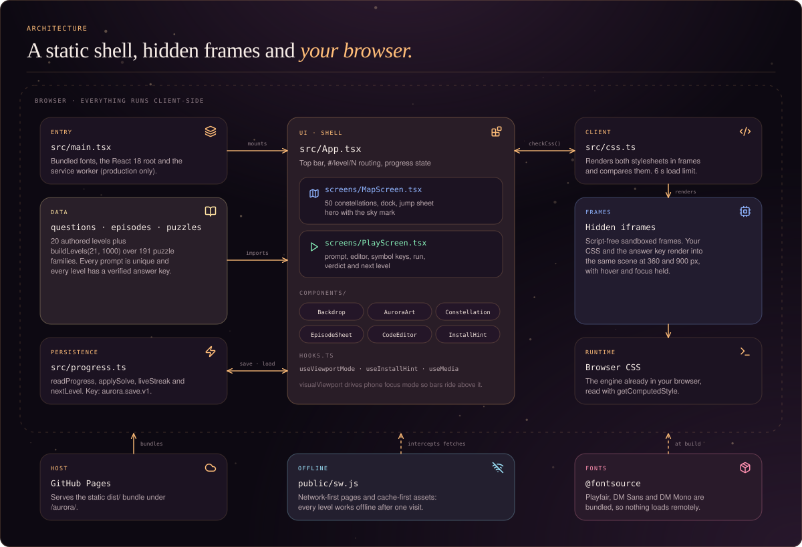

The app is small and split by responsibility: one shell, three screens, a handful of components, one data layer and one engine file.

**`main.tsx`** loads the bundled fonts, mounts `App` inside `React.StrictMode` and, in production builds only, registers the service worker.

**`App.tsx`** is the shell. It owns the progress record, draws the top bar and the backdrop, and chooses between the map, a level and the terminal. The open level lives in the URL hash as `#/level/N`, and the sandbox at `#/terminal`, so the iOS edge swipe or the Android back gesture returns to the map instead of leaving the app.

**`screens/MapScreen.tsx`**, **`screens/PlayScreen.tsx`** and **`screens/TerminalScreen.tsx`** are the three views. Components in `components/` are `Accessory`, `Backdrop`, `AuroraArt`, `CodeEditor`, `Constellation`, `EpisodeSheet`, `InstallHint`, `LogoMark`, `Preview` and `Sheet`. `hooks.ts` holds `useEditing`, `useViewportMode`, `useInstallHint` and `useMedia`.

**Data** is `questions.ts`, `episodes.ts`, `puzzles.ts` and `scenes.ts`. Twenty levels are authored. The other 980 come from `buildLevels(21, 1000)` over 191 puzzle families, each rendered in one of twelve scenes.

**`css.ts`** is the engine. It builds the hidden documents, snapshots computed styles, compares them and lints your code. There is no worker and no runtime to load.

**`progress.ts`** reads, validates and writes the save record under `aurora.save.v1`.

---

<a id="the-check"></a>
##  The check

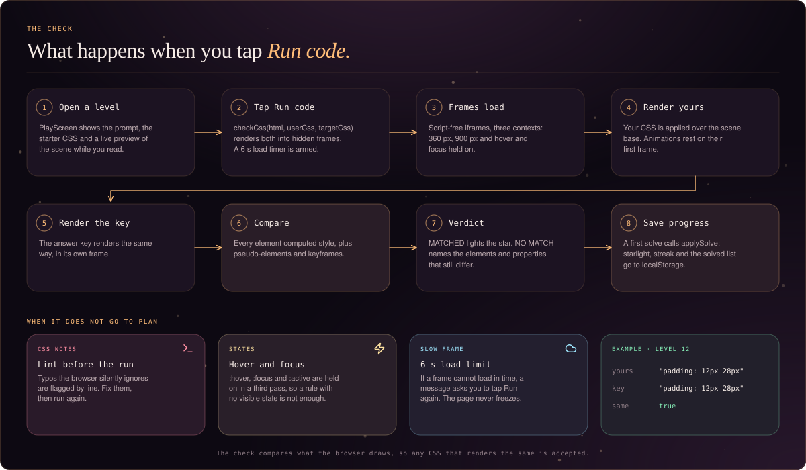

A run is a comparison of two renders. The engine puts your CSS and the authored answer into the same markup, in two hidden frames, and asks the browser what it computed for every element. Any CSS that renders the same is a correct answer, whatever the selectors, shorthands or order.

```ts
// css.ts, simplified
export async function checkCss(html: string, userCss: string, targetCss: string) {
  const runs = await Promise.all(CONTEXTS.map(async ([label, width, force]) => ({
    label,
    mine: await snapshot(html, userCss, width, force),    // your stylesheet
    key:  await snapshot(html, targetCss, width, force),  // the authored one
  })))
  // every "element|property" key is compared, then noise is collapsed
  return { solved: diffs.length === 0, diffs: tidy(diffs) }
}
```

Three contexts are rendered for every check:

| Context | Width | Why |
|---|---|---|
| Resting | 360 px | The phone layout, with every base rule |
| Wide | 900 px | So media and container queries are held to account |
| Held states | 360 px | `:hover`, `:focus`, `:focus-within` and `:active` are rewritten to plain classes and switched on |

What is compared, per element: every computed property, the `::before` and `::after` boxes when they have content, the text pseudo-elements (`::first-line`, `::first-letter`, `::marker`, `::placeholder`), and every running animation (keyframes, duration, delay, iterations, direction, fill and easing). Time is frozen first: transitions jump to their end value and animations rest on their first frame, so the result never depends on a timer.

Scenes sit on a zero-specificity base written with `:where()`, so your rules always win without `!important`.

| Limit | Value | What happens |
|---|---|---|
| Load | 6 seconds | If a frame cannot load in time, a message asks you to run again |
| Lint | Before every run | Unknown properties, bad values, missing braces and unclosed comments are reported by line |

| Piece | Role |
|---|---|
| `buildDoc(html, css, force)` | The full hidden document: base, then your CSS |
| `forceStates(css)` | Maps interactive pseudo-classes to `.is-hover`, `.is-focus`, `.is-active` and `.is-within` |
| `holdStates(doc, on)` | Applies those classes to a rendered preview, used by the HOLD switch |
| `checkCss(html, user, target)` | Resolves `{ solved, diffs }` |
| `lintCss(code)` | Returns up to six `{ line, text }` issues |

---

<a id="curriculum"></a>
##  Curriculum

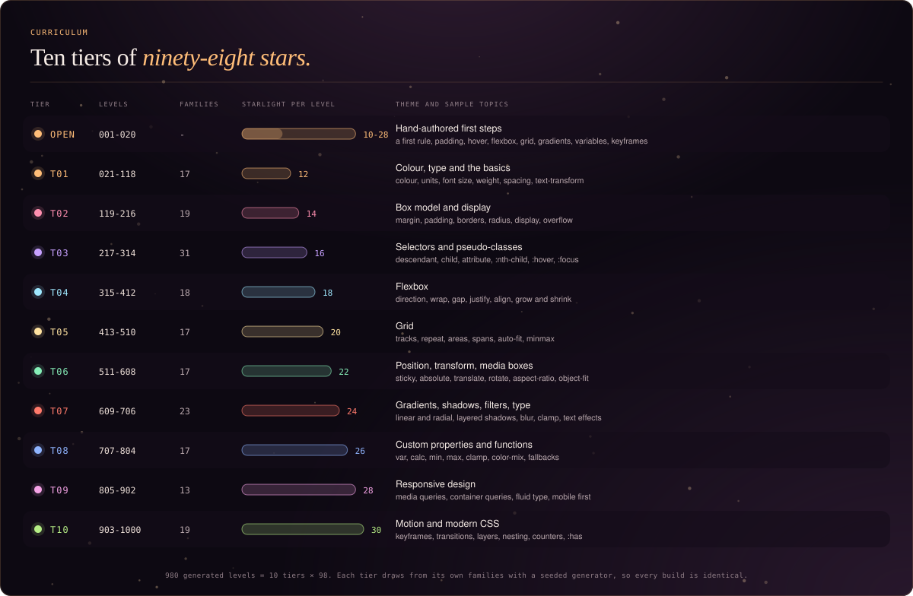

Levels 1 to 20 are hand-authored first steps. Levels 21 to 1000 come from a library of **191 puzzle families**, split into ten tiers of 98 levels. Every level is deterministic, so the game is identical on every build, and no two prompts are the same. Every one of the 1,000 answer keys has been rendered and verified in a real browser.

| Tier | Levels | Families | Starlight | Theme |
|---|---|---|---|---|
| Open | 001 to 020 | authored | 10 to 28 | Hand-authored first steps |
| 1 | 021 to 118 | 17 | 12 | Colour, type and the basics |
| 2 | 119 to 216 | 19 | 14 | Box model and display |
| 3 | 217 to 314 | 31 | 16 | Selectors and pseudo-classes |
| 4 | 315 to 412 | 18 | 18 | Flexbox |
| 5 | 413 to 510 | 17 | 20 | Grid |
| 6 | 511 to 608 | 17 | 22 | Position, transform, media boxes |
| 7 | 609 to 706 | 23 | 24 | Gradients, shadows, filters, typography |
| 8 | 707 to 804 | 17 | 26 | Custom properties and CSS functions |
| 9 | 805 to 902 | 13 | 28 | Responsive design |
| 10 | 903 to 1000 | 19 | 30 | Motion and modern CSS |

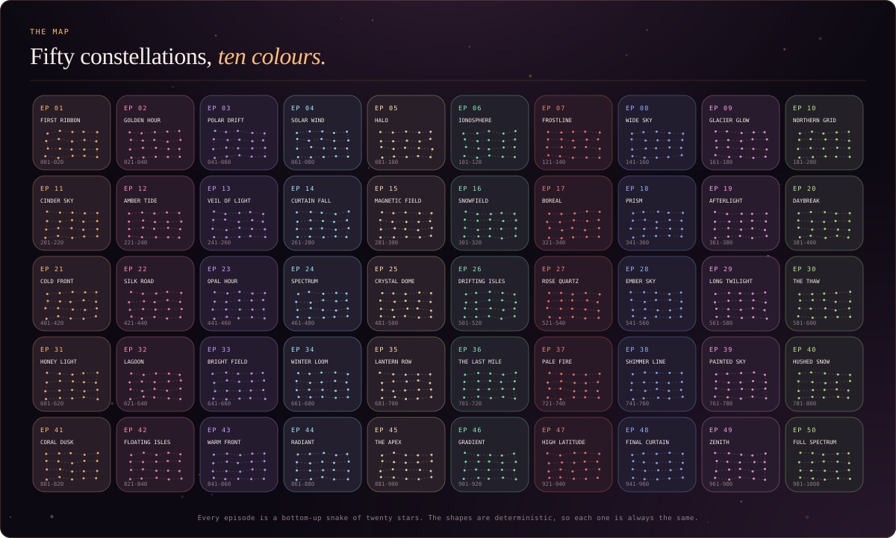

Episode names live in `episodes.ts` and the ten-colour palette in `questions.ts`. The palette repeats every ten episodes. Levels are drawn in twelve scenes (`card`, `list`, `nav`, `boxes`, `grid`, `form`, `post`, `deck`, `media`, `sticky`, `areas` and `container`) so each topic is practised on the markup where it matters.

---

<a id="progression"></a>
##  Progression

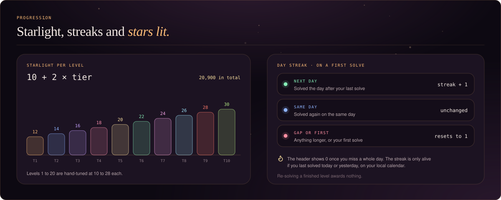

Progress is only recorded on the first solve of a level. Re-solving a finished level changes nothing, and tells you the star was already lit.

| Rule | Behaviour |
|---|---|
| Starlight | Added once per level: authored levels award 10 to 28, generated levels `10 + 2 × tier` |
| Total available | 20,900 starlight across all 1,000 levels |
| Streak, next day | Solving the day after your last solve adds 1 |
| Streak, same day | Unchanged |
| Streak, gap or first solve | Resets to 1 |
| Day boundary | Your **local** calendar date |
| Displayed streak | Only alive if you last solved today or yesterday; otherwise the header shows 0 |
| Next level | The first unsolved level on the whole path, or `null` when every star is lit |

```jsonc
// localStorage["aurora.save.v1"]
{ "done": [1, 2, 3], "streak": 3, "lastDay": "2026-10-22", "xp": 36 }
```

On load, the saved record is validated: level ids are de-duplicated and kept only if they are integers between 1 and 1000, and any malformed value falls back to zero.

---

<a id="terminal"></a>
##  Terminal

The terminal is a free sandbox for when you want to try something without a level. Open it from the top bar, or go straight to `#/terminal`.

- **A CSS editor** with the same symbol row and phone focus mode as a level.
- **A MARKUP panel** so you can edit the HTML the stylesheet is applied to.
- **A live canvas** with 360 and 900 px switches and a **HOLD** switch that pins `:hover`, `:focus` and `:active` on.
- **An Examples sheet** of ready-made starting points to load and remix.
- **Lint notes** when you run, using the same linter as the levels.
- **An undo toast** after loading an example, so nothing is lost by accident.

The sandbox is saved under `aurora.sandbox.v1` as `{ code, html }`, and never touches your level progress.

---

<a id="mobile"></a>
##  Mobile

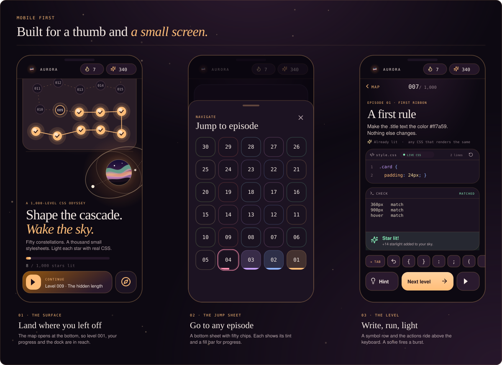

*The mockups are illustrations drawn from the real layout and design tokens, not screenshots.*

- **Keyboard-aware.** Phone focus mode reads `visualViewport`, so the symbol row and the actions ride above the keyboard. When you are typing, the chrome gets out of the way to reclaim space.
- **A symbol row that never steals focus.** Keys cancel `pointerdown`, so tapping a symbol does not dismiss the keyboard. Brackets and quotes pair and step over like a real keyboard.
- **A live preview.** The scene you are styling sits right under the prompt, so every change is visible at once.
- **Back gesture.** The open level is in the URL hash, so swiping back returns to the map.
- **Safe areas.** Layout respects the notch and home bar through `env(safe-area-inset-*)`.
- **Touch targets.** Buttons, keys and chips are 44 px or larger.
- **Feedback.** A ripple follows each tap outside the editor, and a first solve vibrates briefly on devices that support it.

---

<a id="offline-and-install"></a>
##  Offline and install

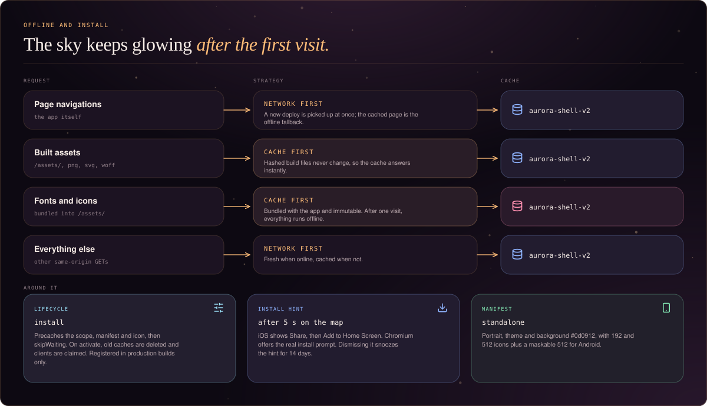

`public/sw.js` is registered in production builds only, so the dev server is never cached. It is scope-relative, so it works under any base path.

| Request | Strategy | Cache |
|---|---|---|
| Page navigations | Network first, cached page as the offline fallback | `aurora-shell-v2` |
| Built assets (`/assets/`, png, svg, woff) | Cache first | `aurora-shell-v2` |
| Everything else on the same origin | Network first | `aurora-shell-v2` |

Pages are network first so a new deploy is picked up immediately. Built files are hashed and immutable, and the fonts ship inside them, so once one visit has loaded the app, every level runs offline. The engine is the browser, so there is no separate runtime to cache.

**Install.** The manifest declares a standalone, portrait app with the abyss as its theme and background colour. After five seconds on the map, `useInstallHint` shows a small card:

- **iOS** has no install event, so the card teaches Share, then **Add to Home Screen**.
- **Chromium** browsers get the real install prompt through `beforeinstallprompt`.
- Dismissing the card snoozes it for 14 days (`aurora.installHint`), and it never shows in an installed app.

---

<a id="design-system"></a>
##  Design system

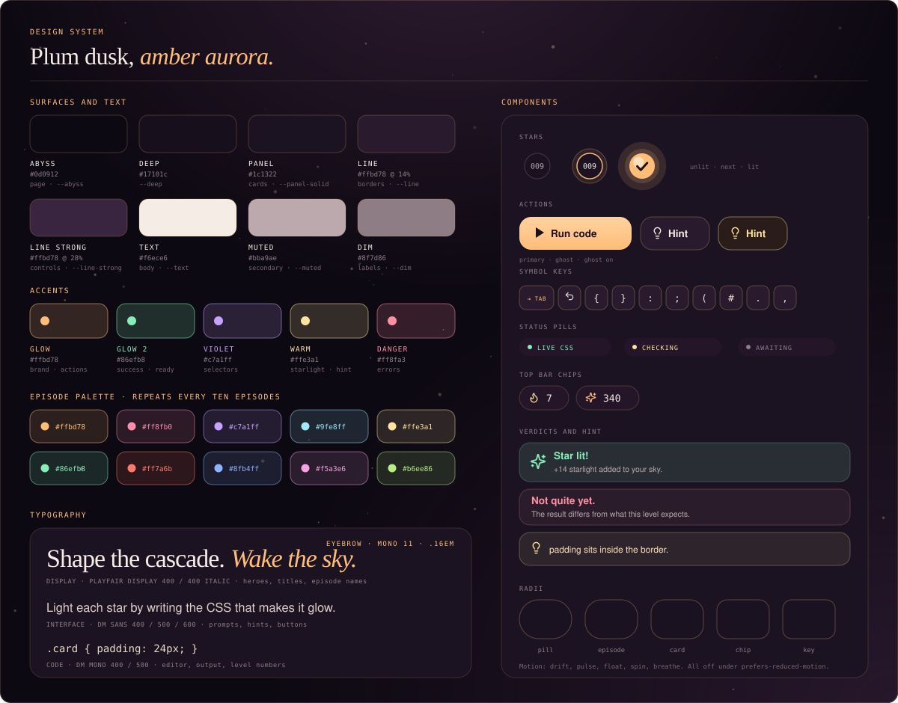

The tokens are declared on `:root` in `src/style.css`. The direction is *plum dusk, amber aurora, serif headlines, mono labels*, built mobile first. It shares its art direction with the other apps in the family and swaps the palette so each one reads as its own game.

### Colour tokens

| Token | Value | Use |
|---|---|---|
| `--abyss` | `#0d0912` | Page background |
| `--deep` | `#17101c` | Deep surface |
| `--panel-solid` | `#1c1322` | Cards, with `--panel` at 90% |
| `--line` | `rgba(255, 189, 120, .14)` | Hairline borders |
| `--line-strong` | `rgba(255, 189, 120, .28)` | Controls and sheets |
| `--text` | `#f6ece6` | Primary text |
| `--muted` | `#bba9ad` | Secondary text |
| `--dim` | `#8f7d86` | Labels and counters |
| `--glow` | `#ffbd78` | Brand, actions, focus, the next star |
| `--glow-2` | `#86efb8` | Success and a matched check |
| `--violet` | `#c7a1ff` | Selectors |
| `--warm` | `#ffe3a1` | Starlight and hints |
| `--danger` | `#ff8fa3` | Errors and a missed match |

### Episode palette

```
#ffbd78  #ff8fb0  #c7a1ff  #9fe8ff  #ffe3a1
#86efb8  #ff7a6b  #8fb4ff  #f5a3e6  #b6ee86
```

An episode's colour is `palette[(episode - 1) % 10]`. It sets the tint of the card, its stars, its paths and its chip in the jump sheet.

### Typography

```
--serif  Playfair Display  400 / 400 italic   heroes, titles, episode names
--sans   DM Sans           400 / 500 / 600    prompts, hints, buttons
--mono   DM Mono           400 / 500          editor, output, eyebrows, level numbers
```

Fonts are bundled through `@fontsource`, so the app makes no request to Google Fonts. Headlines are regular Playfair with an italic amber emphasis, such as *Wake the sky.* Eyebrows are 11 px mono, upper case, tracked at `.16em`.

### Shape, light and motion

- **Radii** run from pills (99 px) through episode cards (22), cards (18), chips (14) and keys (12).
- **Light.** Panels are glassy plum with a tint wash. Lit stars carry a layered glow. The backdrop is radial gradients plus drifting specks.
- **Motion.** `drift`, `pulse`, `float`, `spin` and `breathe`, plus a tap ripple. All animation and transitions are switched off under `prefers-reduced-motion: reduce`.
- **Icons.** [Lucide](https://lucide.dev) throughout the app and in this README.

### The mark

The mark is a sky window: a dusk gradient of deep violet into amber, four ribbons of aurora over two dark hills, a soft halo, two orbit rings and a short dotted constellation of three stars. It is the `AuroraArt` component in the app, and the single source for every raster icon.

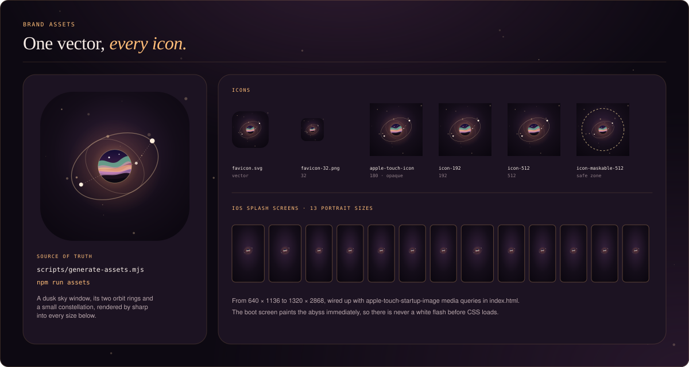

`scripts/generate-assets.mjs` renders the favicon, Apple touch icon, the 192 and 512 icons, a maskable icon (with the glyph inside the Android safe zone) and 13 iOS splash screens with [sharp](https://sharp.pixelplumbing.com). Run it with `npm run assets`.

---

<a id="authoring-levels"></a>
##  Authoring levels

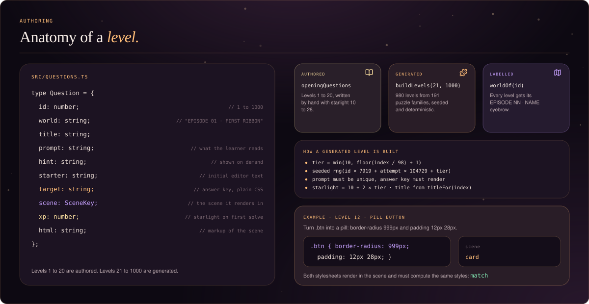

To change one of the first twenty levels, edit `openingQuestions` in `src/questions.ts`. To add or change generated levels, edit the families in `src/puzzles.ts`. Each family is a function that takes a seeded random source and returns a prompt, an answer key, a hint and a topic, and names the scene it renders in.

```ts
// puzzles.ts, one family in tier 2
g('Padding', 'card', (r) => {
  const s = r.pick(['.card', '.btn', '.badge']), n = r.int(4, 40)
  return [`Give ${s} ${n}px of padding on every side.`,
          blk(s, `padding: ${n}px`),
          'padding is the space inside the border.']
})
```

`buildLevels` picks a family for each level from its tier, seeds the generator from the level id, and retries until the prompt is unique. Every answer key is a plain stylesheet, so the check can render it.

Guidelines:

- Write one clear prompt and a one-line hint. Name the selector and the exact values, so there is one thing to build.
- Make sure the starter does not already match the answer. A level whose starting CSS passes is a bug, and the verification run catches it.
- A level that needs a state, such as `:hover`, sets `state: true` so the checker holds it. A level that needs the desktop layout sets `wide: true`.
- Prefer the scenes in `scenes.ts`. They sit on a `:where()` base with zero specificity, so learner rules always win.
- Keep ids 1-based and contiguous. The map is built for 50 episodes of 20, set in `episodes.ts`.

---

<a id="getting-started"></a>
##  Getting started

**Prerequisites:** Node.js 22 or later, and npm.

```bash
git clone https://github.com/hassanireza/aurora.git
cd aurora
npm install
npm run dev
```

Vite serves the app from a relative base, so it opens at **http://localhost:5173/** and works under any repository name once deployed.

```bash
npm run build      # tsc -b, then vite build into dist/
npm run preview    # serve the production build locally
npm run assets     # regenerate icons, favicons and iOS splash screens
```

No download is needed the first time you press **Run**: the engine is your browser, so the app works with no connection once it has loaded. In production builds the service worker keeps it for offline use.

### Forking under another name

Nothing is tied to the repository name. `base` in `vite.config.ts` is `'./'`, so the manifest, the service worker and the HTML all resolve relative to wherever the site is served. If you prefer an absolute path, set it to your repo name:

```ts
// vite.config.ts
export default defineConfig({ plugins: [react()], base: '/your-repo-name/', /* ... */ })
```

Then update the live-site links in this README.

---

<a id="deployment"></a>
##  Deployment

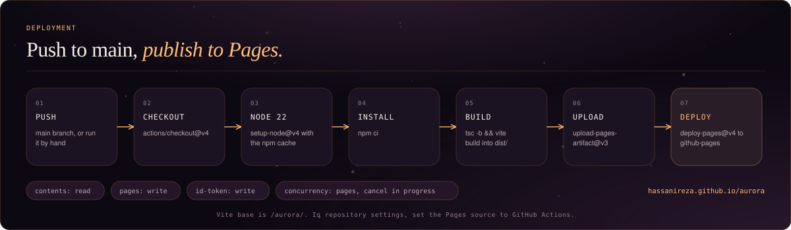

`.github/workflows/pages.yml` runs on every push to `main` and on manual dispatch. It sets up Node 22 with npm caching, runs `npm ci` and `npm run build`, uploads `dist/` and deploys it with `actions/deploy-pages`.

**To enable:** open **Settings, Pages, Build and deployment** and choose **GitHub Actions** as the source. The site is then served at `https://hassanireza.github.io/aurora/`.

---

##  Project structure

```
aurora/
├── assets/                          README artwork
│   ├── banner.svg                   Header banner
│   ├── footer.svg                   Footer mark
│   ├── pillars.svg                  Map, editor, check
│   ├── journey.svg                  Map anatomy
│   ├── architecture.svg             Component diagram
│   ├── run-flow.svg                 The check pipeline
│   ├── curriculum.svg               Ten tiers
│   ├── episodes.svg                 Fifty constellations
│   ├── progress.svg                 Starlight and streak rules
│   ├── mobile.svg                   Phone mockups
│   ├── offline.svg                  Service worker and install
│   ├── design-system.svg            Tokens, type, components
│   ├── brand-assets.svg             Icon and splash pipeline
│   ├── level-anatomy.svg            The Question type
│   ├── deploy.svg                   CI/CD pipeline
│   ├── badges/                      Brand-styled badge SVGs
│   └── icons/                       Lucide icons used in headings
├── public/
│   ├── favicon.svg, favicon-32.png  Tab icons
│   ├── apple-touch-icon.png         iOS Home Screen icon
│   ├── icon-192.png, icon-512.png   Install icons
│   ├── icon-maskable-512.png        Android adaptive icon
│   ├── splash/                      13 iOS splash screens
│   ├── manifest.webmanifest         Web App Manifest
│   └── sw.js                        Service worker
├── scripts/
│   └── generate-assets.mjs          Renders every icon and splash from one vector
├── src/
│   ├── main.tsx                     Entry: fonts, root, service worker registration
│   ├── App.tsx                      Shell: top bar, hash routing, progress state
│   ├── screens/
│   │   ├── MapScreen.tsx            Episodes, hero, dock, jump sheet
│   │   ├── PlayScreen.tsx           Prompt, preview, editor, keys, verdict
│   │   └── TerminalScreen.tsx       Free CSS sandbox
│   ├── components/
│   │   ├── Accessory.tsx            Symbol row and editing keys
│   │   ├── AuroraArt.tsx            The sky window mark and hero art
│   │   ├── Backdrop.tsx             Drifting specks and tap ripple
│   │   ├── CodeEditor.tsx           CodeMirror setup and handle
│   │   ├── Constellation.tsx        One episode's stars and paths
│   │   ├── EpisodeSheet.tsx         Jump to episode bottom sheet
│   │   ├── InstallHint.tsx          Add to Home Screen card
│   │   ├── LogoMark.tsx             Compact mark for the top bar
│   │   ├── Preview.tsx              Live scene preview with state hold
│   │   └── Sheet.tsx                Shared bottom sheet
│   ├── css.ts                       The engine: render, compare, lint
│   ├── scenes.ts                    Twelve scenes on a :where() base
│   ├── questions.ts                 Authored levels, assembly, palette
│   ├── puzzles.ts                   191 puzzle families and buildLevels()
│   ├── episodes.ts                  Names and counts
│   ├── examples.ts                  Terminal examples
│   ├── sandbox.ts                   Terminal save record
│   ├── progress.ts                  Save record, streaks, next level
│   ├── hooks.ts                     Editing, viewport mode, install hint, media
│   ├── art.ts                       Shared mark geometry
│   └── style.css                    Tokens and all styles
├── .github/workflows/pages.yml      CI/CD to GitHub Pages
├── index.html                       Boot screen, meta, splash links
├── vite.config.ts                   Relative base
└── package.json
```

---

##  Component reference

### `<App />`

| State | Type | Purpose |
|---|---|---|
| `progress` | `{ done, streak, lastDay, xp }` | Solved ids, streak and starlight, written to `localStorage` on change |
| `route` | hash | `#/level/N`, `#/terminal` or the map |

`open(id)` pushes `#/level/id` from the map, or replaces it when moving between levels. `close()` goes back in history when it pushed, and otherwise clears the hash. The document title follows the level.

### `<MapScreen />`, `<PlayScreen />` and `<TerminalScreen />`

| Component | Notes |
|---|---|
| `MapScreen` | Derives `done`, `next` and `resume`, then lands on the right episode |
| `PlayScreen` | Tracks `code`, `verdict`, `diffs`, `attempts`, `hint` and `reveal`. `verdict` is one of `idle`, `busy`, `ok`, `wrong`, `error` |
| `TerminalScreen` | Edits `{ code, html }`, previews at 360 or 900 px, with HOLD and Examples |

On `PlayScreen`, a wrong answer counts as an attempt. After two, **Show what is expected** appears. The status label reads `AWAITING`, `CHECKING`, `MATCHED`, `NO MATCH` or `ERROR`, and a missed check lists the elements and properties that still differ.

### `css.ts`

```ts
buildDoc(html, css, force?)       // the hidden document: base, then your CSS
forceStates(css)                  // :hover, :focus, :active to plain classes
holdStates(doc, on)               // pin those classes on a rendered preview
checkCss(html, userCss, target)   // Promise<{ solved, diffs }>
lintCss(code)                     // Issue[], typos the browser would ignore
```

`PHONE_W` is 360 and `WIDE_W` is 900. A frame that does not load within 6 seconds rejects with `TIMEOUT`, which `PlayScreen` turns into a plain-language message.

### `progress.ts`

```ts
readProgress()                 // parse and validate the save record
writeProgress(p)               // persist it, ignoring private-mode failures
applySolve(p, id, xp)          // first solve only: starlight, streak, lastDay
liveStreak(p)                  // the streak, or 0 once it has gone stale
nextLevel(p)                   // first unsolved level, or null
```

### `Question`

```ts
type Question = {
  id: number; world: string; title: string; prompt: string; hint: string
  starter: string; target: string; scene: SceneKey; html: string; height: number
  xp: number; topic?: string; wide?: boolean; state?: boolean
}
```

---

##  Privacy and data

| What | Where | Why |
|---|---|---|
| Solved levels, streak, last solve day, starlight | `localStorage`, key `aurora.save.v1` | Resume where you left off |
| Terminal code and markup | `localStorage`, key `aurora.sandbox.v1` | Keep your sandbox between visits |
| Install card snooze time | `localStorage`, key `aurora.installHint` | Do not nag for 14 days |
| Your code | Memory and a script-free hidden frame | Rendered locally and discarded |
| Network requests | GitHub Pages only | The app itself |

There is no analytics code, no server of our own and no request to a font service, because the typefaces ship with the app. Clearing site data removes the saved progress and the caches.

---

<a id="technical-notes"></a>
## 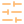 Technical notes

These are the current boundaries of the project, stated plainly.

- **The check follows your browser.** Computed styles come from the engine you are using, so a feature your browser does not support is judged by what it actually renders. Use a current Chrome, Safari or Firefox.
- **Equivalent CSS is accepted.** Correctness is judged by what is drawn, so a different selector or shorthand that renders the same passes.
- **Time is frozen.** Transitions are taken at their end value and animations at their first frame, with keyframes and timing compared separately.
- **Offline needs a production build.** The service worker is registered only when `import.meta.env.PROD` is true.
- **Levels are fixed at 1,000.** The map is built for 50 episodes of 20, and the interface text says 1,000, so changing the count also means editing `episodes.ts` and the hero copy.
- **No automated tests or linter** are configured in `package.json` yet.

---

<a id="licenses"></a>
##  Credits and third-party components

| Component | License | Notes |
|---|---|---|
| React and React DOM | MIT | UI |
| CodeMirror 6, `@uiw/react-codemirror`, `@codemirror/lang-css`, `@lezer/highlight` | MIT | Editor and syntax highlighting |
| lucide-react | ISC | Interface icons, also used in this README |
| Vite, TypeScript | MIT, Apache 2.0 | Build tooling |
| sharp | Apache 2.0 | Dev dependency that renders icons and splash screens |
| Playfair Display, DM Sans, DM Mono | SIL OFL 1.1 | Bundled through `@fontsource` |

---

##  Contributing

1. Fork the repository
2. Create a branch: `git checkout -b feat/my-change`
3. Make your changes and run `npm run build`
4. Open a pull request against `main`

Guidelines:

- **Exact prompts.** Name the selector and the values, so there is one thing to build.
- **Real answer keys.** Every key is plain CSS that renders in its scene, and no starter may already pass.
- **Match the look.** Use the tokens in `:root`, glassy rounded panels, one tint per episode, and DM Mono for anything that is code, a number or an eyebrow.
- **Respect reduced motion.** New animation must be covered by the `prefers-reduced-motion` rule.
- **One vector for the brand.** Change the mark in `scripts/generate-assets.mjs` and `AuroraArt.tsx`, then run `npm run assets`.

---

<div align="center">

<br/>

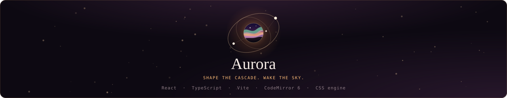

</div>
